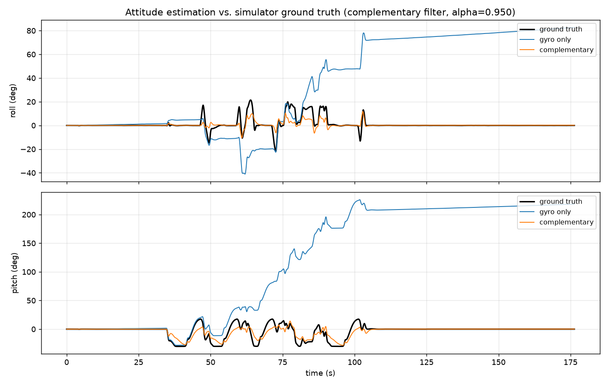
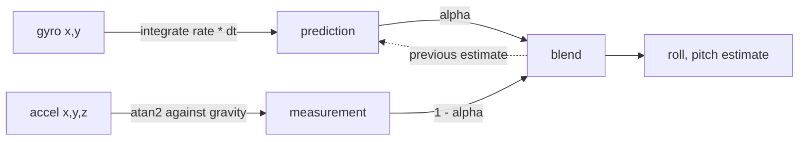

# attitude-estimator — complementary filter for roll and pitch, validated against simulator ground truth



**What it is:** a gyro/accelerometer fusion filter that estimates aircraft roll
and pitch, scored against known-correct attitude from an ArduCopter SITL
simulation. The point of using a simulator is that the right answer is
available, so claims about accuracy are measured rather than asserted.

**Status:** working in Python, validated in simulation. Not yet on hardware —
the C port to a Teensy 4.1 is the next step.

---

## Results

Scored against simulator ground truth over a 176 s flight with peaks of
22° roll and 30° pitch. RMS error in degrees, lower is better:

| Estimator | Roll | Pitch | |
|---|---|---|---|
| gyro only | 52.30 | 155.75 | integrates its own bias, runs away |
| always output level | 5.05 | 11.86 | the baseline any real filter must beat |
| accelerometer only | 4.42 | 6.81 | no drift, but blind under acceleration |
| **complementary (α=0.95)** | **3.75** | **6.32** | |

The measured gyro bias is +0.47°/s in roll and +1.24°/s in pitch. Over 176 s
that integrates to 83° and 218° of error, which is exactly what the gyro-only
row shows.

### Choosing α

α sets how much the gyro is trusted between accelerometer corrections. It is
the only tuning parameter, and the optimum is a real tradeoff rather than
"higher is smoother":

| α | roll RMS | pitch RMS | time constant |
|---|---|---|---|
| 0.90 | 4.06 | 6.55 | 0.4 s |
| **0.95** | **3.75** | **6.32** | **0.8 s** |
| 0.98 | 3.78 | 6.46 | 2.0 s |
| 0.99 | 4.91 | 9.03 | 4.0 s |
| 0.995 | 8.04 | 16.37 | 8.0 s |
| 0.999 | 24.56 | 58.72 | 40.0 s |

Too high and gyro bias leaks through before gravity can correct it. Too low
and accelerometer noise comes straight out the other side.

## How it works



Two sensors with opposite failure modes. The gyro is accurate instant to
instant but integrating its bias accumulates unbounded error. The
accelerometer is noisy and wrong whenever the vehicle accelerates, but it
measures gravity, which never drifts. Each step predicts forward with the
gyro, computes an independent tilt from gravity, and takes a weighted
average. A Kalman filter would estimate the weights from a noise model
instead of fixing them; at this scale a constant α costs little and is far
easier to reason about.

## What went wrong

**The first dataset could not validate anything.** `data/flight1.csv` is a
takeoff, hover, and landing. The aircraft never tilted past 0.43°, so an
estimator that outputs zero forever scores 0.02° RMS — better than any real
filter can do. I only caught this because the empty function stub "scored"
suspiciously well. `collect/collect_flight.py` exists to fix that: it drives
SITL through 13 full-speed velocity reversals in GUIDED mode, forcing the
copter to its 30° bank limit, then extracts raw IMU and ground truth from the
dataflash log.

**Both accelerometer signs were backwards.** The filter initially scored
*worse* than outputting a constant. The cause was sign conventions: the log's
`acc_z` reads −9.8 when level, and my roll and pitch formulas each had a sign
inverted. Rather than re-derive the body frame, I correlated every candidate
formula against ground truth and kept the one that came out positive. Both
flipped. This is why the code comments say the signs were determined
empirically — a frame diagram is easy to get backwards twice.

**Debugging the data collection taught the same lesson.** The flight script
hung for hours on `motors_armed_wait()`, which blocks forever if arming is
refused, and I was discarding the STATUSTEXT messages in which ArduPilot
explains exactly why it refused. The actual cause was not arming checks but
an unconverged EKF: a 3D GPS fix is not the same as a usable position
estimate.

**Known limitation, unsolved.** The estimate undershoots peak tilt — truth
reaches −30° where the filter reaches about −22°. This is physical, not a
bug: a multirotor banks in order to accelerate, so the accelerometer is partly
aligned with the tilt it is supposed to measure and under-reports it. The
standard fixes are to reject accelerometer updates when |a| departs from g, or
to subtract kinematic acceleration estimated from GPS velocity. The latter is
close to what ArduPilot's EKF3 actually does.

## C port

`c/attitude.c` is the filter as it will run on hardware: no allocation, no I/O,
no libc beyond `math.h`, caller-owned state. It compiles clean under
`-Wall -Wextra -Wpedantic -Wdouble-promotion -Wconversion`. The
`-Wdouble-promotion` flag is there deliberately — one stray `double` on a
single-precision FPU drops the whole expression into software emulation, and
`atan2` instead of `atan2f` is the usual way that happens.

`c/replay.c` is a host harness, not firmware. It exists to prove the C answers
match the Python reference before any of it meets a microcontroller:

| | C (float32) | Python (float64) |
|---|---|---|
| complementary | 3.74642° / 6.32076° | 3.74642° / 6.32076° |
| gyro only | 52.30336° / 155.74855° | 52.30337° / 155.74859° |

The filter agrees to every digit printed; the gyro-only integrator does not.
That is the expected result rather than a coincidence. The filter is a feedback
loop — gravity pulls it back every step, so rounding error cannot accumulate.
Open-loop integration has nothing correcting it, so 4409 steps of float32
rounding surface in the fifth digit. Single precision is safe here because of
the structure, not by luck.

```bash
cd c && make && ./replay ../data/flight2.csv 0.95
```

## Reproduce it

```bash
python collect/collect_flight.py data/flight2.csv   # fly SITL, extract the log
python estimator.py data/flight2.csv                # score it, write result.png
```

Collection needs a built ArduCopter SITL at `~/ardupilot` and `pymavlink`.
Scoring needs only `matplotlib`; the filter itself is standard library.

On current macOS, building that SITL requires an upstream fix — I hit the
link failure, filed
[ArduPilot#34890](https://github.com/ArduPilot/ardupilot/issues/34890),
tested the fix in
[#34924](https://github.com/ArduPilot/ardupilot/pull/34924), and wrote the
follow-up in
[#34928](https://github.com/ArduPilot/ardupilot/pull/34928).

## Layout

| | |
|---|---|
| `estimator.py` | the filter, baselines, α sweep, plotting |
| `collect/collect_flight.py` | flies SITL and extracts IMU + ground truth |
| `data/flight1.csv` | the hover log that could not validate anything (kept deliberately) |
| `data/flight2.csv` | 4409 samples, 176 s, 25 Hz, with real attitude dynamics |
| `c/attitude.{h,c}` | the filter in portable C, destined for the Teensy |
| `c/replay.c` | host harness that validates the C against the Python |

## Next

- Run the C filter on a Teensy 4.1 with an MPU6050 — the filter is ported and
  validated; what remains is the I2C driver and sampling loop
- Reject accelerometer updates when |a| is far from g, and re-measure
- Estimate and subtract gyro bias online rather than letting α absorb it
